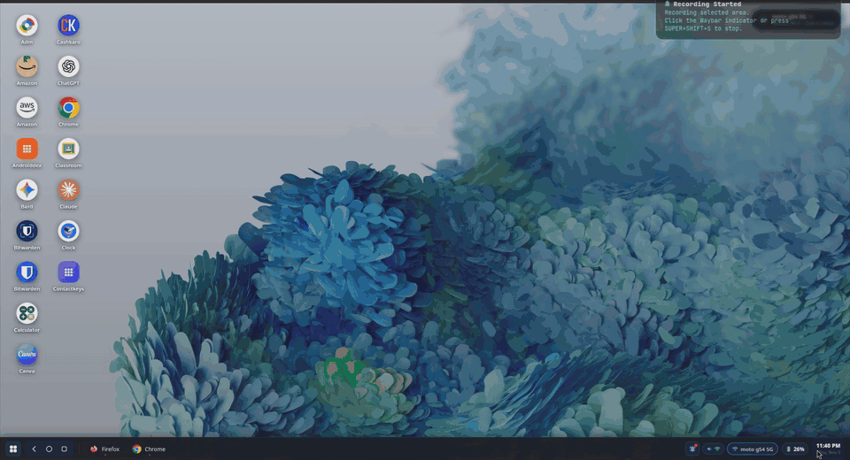
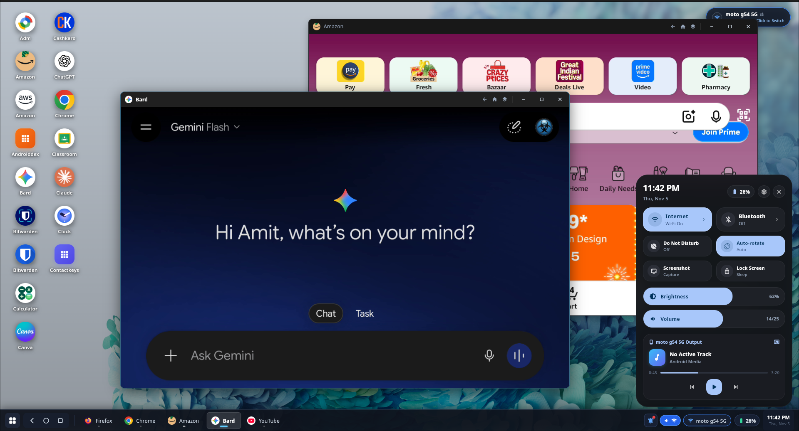

# Open Android DeX

[](https://github.com/Bit-manipulators/open-android-dex/actions)
[](LICENSE)
[-teal.svg)](#requirements)
[](#android-device-support)
[](docs/GOOD_FIRST_ISSUES.md)
[](.devcontainer)

An open-source desktop environment that transforms your Android smartphone or tablet into a multi-window workstation under **Linux** (Wayland and X11) — featuring resizable floating windows, an interactive DeX taskbar, app drawer, low-latency screen streaming, and keyboard/mouse input mapping.

<p align="center">
  
</p>

<p align="center">
  
</p>
<p align="center">
  <em>True multi-window Android desktop workstation on Linux — floating resizable apps, taskbar, and quick settings with zero system bar clutter.</em>
</p>

---

## 📑 Table of Contents

- [Overview & Goals](#overview--goals)
- [Feature Status Matrix](#feature-status-matrix)
- [Architecture & Shell Options](#architecture--shell-options)
  - [1. Flutter Desktop Compositor (Primary)](#1-flutter-desktop-compositor-primary)
  - [2. Python / GTK4 Shell (Lightweight Fallback)](#2-python--gtk4-shell-lightweight-fallback)
  - [3. Android Companion App](#3-android-companion-app)
- [System Requirements](#system-requirements)
- [Quick Start Guide](#quick-start-guide)
  - [Running the Flutter Desktop Shell](#running-the-flutter-desktop-shell)
  - [Running the Python / GTK4 Shell](#running-the-python--gtk4-shell)
- [Testing & Quality Assurance](#testing--quality-assurance)
- [Provenance & Reverse-Engineering Transparency](#provenance--reverse-engineering-transparency)
- [Documentation & Contributing](#documentation--contributing)
- [License](#license)

---

## Overview & Goals

**Open Android DeX** aims to deliver a modern, multi-window desktop computing experience powered directly by your personal Android phone connected to a Linux laptop or external monitor.

### Key Project Objectives
* **True Multi-Window Workspace**: Float, drag, resize, maximize, and minimize independent Android applications across an expansive desktop canvas.
* **Low Latency & High Frame Rate**: Decode 60 FPS video streams in-process directly to GPU textures via hardware-accelerated pipelines.
* **Clean-Room Open Source**: 100% original code licensed under GPL-3.0, without proprietary binaries, proprietary libraries, or vendor lock-in.
* **Dual Architecture Flexibility**: A modern, feature-rich Flutter compositor alongside an ultra-lightweight GTK4 shell.

---

## Feature Status Matrix

| Feature | Status | Description |
| :--- | :--- | :--- |
| **8-Way Window Resizing** | ✅ **Implemented** | Smooth edge and corner dragging with geometry persistence |
| **Z-Index Window Ordering** | ✅ **Implemented** | Active window elevation, focus switching, and drop shadows |
| **In-Process Video Textures** | ✅ **Implemented** | Native C++ FFmpeg decoding from headless scrcpy pipes |
| **DeX Bottom Taskbar** | ✅ **Implemented** | 9-dot launcher, Android navigation (Back, Home, Recents), clock |
| **App Drawer & Search** | ✅ **Implemented** | Dynamic package querying with real-time text filtering |
| **Staged Boot Sequencer** | ✅ **Implemented** | 5-step detection and health check (ADB → Device → Link → scrcpy) |
| **Media Volume Control** | ✅ **Implemented** | Hardware volume stepping and mute toggles via ADB |
| **Android Virtual Displays** | 🟡 **Partially Implemented** | Uses `--new-display` on Android 14+; auto-adapts on resize |
| **Real-Time Notification Sync** | 🟡 **Partially Implemented** | `dumpsys` polling in desktop; Companion daemon in Kotlin |
| **Audio Forwarding to Host** | 🔵 **Planned** | PipeWire / PulseAudio integration via scrcpy audio tunnel |
| **Bidirectional Clipboard Sync** | 🔵 **Planned** | Automatic copy-paste synchronization between host and phone |
| **Direct Control Socket Touch** | 🧪 **Experimental** | Direct binary touch packets over scrcpy control port |

*Legend: ✅ Implemented | 🟡 Partially Implemented | 🔵 Planned | 🧪 Experimental*

---

## Architecture & Shell Options

Open Android DeX provides two distinct desktop shells tailored for different use cases:

```
┌─────────────────────────────────────────────────────────────┐
│                 Open Android DeX Ecosystem                  │
├──────────────────────────────┬──────────────────────────────┤
│ Primary: Flutter Compositor  │ Fallback: Python GTK4 Shell  │
│  - Rich multi-window canvas  │  - Low memory footprint      │
│  - In-process FFmpeg decoder │  - Standalone scrcpy window  │
│  - Samsung DeX glassmorphism │  - Fast zero-compile startup │
├──────────────────────────────┴──────────────────────────────┤
│               Shared ADB & Transport Protocols              │
│       (ADB Daemon, Port Forwarding, Headless scrcpy)        │
└─────────────────────────────────────────────────────────────┘
```

For full technical diagrams, data flows, and IPC details, refer to [`docs/ARCHITECTURE.md`](docs/ARCHITECTURE.md).

### 1. Flutter Desktop Compositor (Primary)
* **Code Location:** [`lib/`](lib/) and [`linux/`](linux/)
* **Window Engine:** Draggable and 8-direction resizable window frames with active focus management and minimize/maximize memory.
* **Streaming Engine:** Headless `scrcpy` writes live H.264 video to a named pipe (`$XDG_RUNTIME_DIR/opendex/`), which [`stream_texture.cc`](linux/stream_texture.cc) decodes into an `FlPixelBufferTexture` rendered in real-time.

### 2. Python / GTK4 Shell (Lightweight Fallback)
* **Code Location:** [`app.py`](app.py) and supporting Python modules
* **Model:** Pure PyGObject GTK4 desktop launcher with status bar, app drawer, and system dock.
* **Streaming:** Launches `scrcpy` in an external standalone window matching host compositor conventions.

### 3. Android Companion App
* **Code Location:** [`android_companion/`](android_companion/)
* **Model:** Clean-room Kotlin service featuring `NotificationListenerService` and a loopback-bound TCP daemon (`127.0.0.1:8888`) for event broadcasting.

---

## System Requirements

### Host Linux PC
* **Operating System:** Linux (Arch Linux, Ubuntu 22.04+, Debian 12+, Fedora 38+)
* **Display Server:** Wayland (Hyprland, Sway, GNOME, KDE) or X11
* **Tools:**
  * `adb` (Android Debug Bridge, version 31+)
  * `scrcpy` (version 2.0 - 5.0+)
  * Python 3.10+ (for Python GTK shell and test suite)
  * Flutter SDK 3.24+ (for building the Flutter shell from source)

### Android Device Support
* Any smartphone, tablet, or handheld running **Android 10 through Android 16**.
* **USB Debugging** enabled in *Developer Options*.
* (Optional) **Wireless Debugging** (Android 11+) supported via QR code pairing.

---

## Quick Start Guide

### 🚀 Instant Demo Mode (No Android Phone Needed!)

Want to test, explore, or build features without plugging in a physical phone? You can launch Open Android DeX immediately in simulated **Demo Mode**:

```bash
# Auto-detects Flutter or Python and launches instant Demo Mode:
./scripts/run_demo.sh

# Or run the Python/GTK4 shell directly in demo mode:
python3 app.py --demo
```

---

### 1. Automated Dependency Setup

To automatically detect your Linux distribution and install all system development packages:

```bash
./scripts/dev_setup.sh
```

Or install manually:

**Debian / Ubuntu:**
```bash
sudo apt update
sudo apt install -y adb scrcpy libgtk-4-dev libgtk-3-dev python3-gi gir1.2-gtk-4.0 \
    pkg-config cmake ninja-build clang libavcodec-dev libavformat-dev libswscale-dev libavutil-dev
```

**Arch Linux:**
```bash
sudo pacman -S android-tools scrcpy gtk4 gtk3 python-gobject cmake ninja clang ffmpeg
```

**Fedora:**
```bash
sudo dnf install -y android-tools scrcpy gtk4-devel gtk3-devel python3-gobject \
    cmake ninja-build clang ffmpeg-free-devel
```

### 2. Connect Your Phone
1. Connect your Android phone to your PC via a USB-C data cable.
2. When prompted on your phone, tap **"Always allow from this computer"** to authorize USB debugging.
3. Verify connection:
   ```bash
   adb devices
   ```

---

### Running the Flutter Desktop Shell

```bash
./run_flutter_dex.sh
```

Or via Flutter CLI:
```bash
flutter run -d linux
```

### Running the Python / GTK4 Shell

```bash
python3 app.py
```

Or install as a local command:
```bash
pip install -e .
open-android-dex
```

---

## Testing & Quality Assurance

The repository includes a zero-dependency test runner and full CI integration:

```bash
# Run all unit tests with zero third-party dependencies:
python3 run_tests.py

# Or via pytest:
PYTHONPATH=. pytest tests/ -v

# Run Flutter static analysis
flutter analyze

# Run Flutter tests
flutter test
```

---

## ⚖️ Provenance & Reverse-Engineering Transparency

Open Android DeX is an **independent, clean-room, open-source project**.

* **Reference Software Studied:** Earlier exploratory phases studied compiled reference binaries (`.AppImage`, `libapp.so`, and reference companion JARs) using public binary analysis to understand high-level architectural requirements (such as virtual display binding and video texture pipelines).
* **Public Specifications Used:** All implementations in this repository are based exclusively on publicly documented open-source protocols, including the official [scrcpy protocol](https://github.com/Genymobile/scrcpy), Android Open Source Project (AOSP) documentation, and standard Linux/GTK APIs.
* **Clean-Room Codebase:** No code, strings, proprietary assets, or binaries from any closed-source application are used or distributed in this repository.
* **Third-Party Trademarks:** "Android" and "Samsung DeX" are trademarks of their respective owners. Their mention here is purely descriptive of factual technical compatibility.

For detailed security review and threat models, see [`docs/SECURITY.md`](docs/SECURITY.md).

---

## Documentation & Contributing

Comprehensive architectural and developer guides are available in `docs/`:

* 🌟 **[Good First Issues for Contributors](docs/GOOD_FIRST_ISSUES.md)**: 5 bite-sized, ready-to-solve starter issues with code pointers.
* 📢 **[Community Outreach & Launch Kit](docs/COMMUNITY_SUBMISSIONS.md)**: Ready-to-use posts for Reddit, Hacker News, and Awesome lists.
* 📖 **[Architecture & Data Flow](docs/ARCHITECTURE.md)**: Video decoding, IPC, window management.
* 🛡️ **[Security Policy & Threat Model](docs/SECURITY.md)**: Socket isolation, ADB authorization, and least-privilege review.
* 🗺️ **[Development Roadmap & Issues](docs/ROADMAP.md)**: 6 strategic pillars and 12 actionable issue proposals.
* 🔍 **[Comprehensive Project Audit](docs/PROJECT_AUDIT.md)**: Detailed audit report of all components and bugs.
* 🤝 **[Contribution Guidelines](CONTRIBUTING.md)**: Setup, branch conventions, PR checklist.
* 📜 **[Code of Conduct](CODE_OF_CONDUCT.md)**: Community standards and enforcement.

We warmly welcome external contributors! Check out **[`docs/GOOD_FIRST_ISSUES.md`](docs/GOOD_FIRST_ISSUES.md)** to grab an issue and submit your first PR!

---

## License

This project is licensed under the **GNU General Public License v3.0 (GPL-3.0)** — see the [`LICENSE`](LICENSE) file for details.  
Copyright (c) 2026 [Bit-manipulators](https://github.com/Bit-manipulators/open-android-dex).
