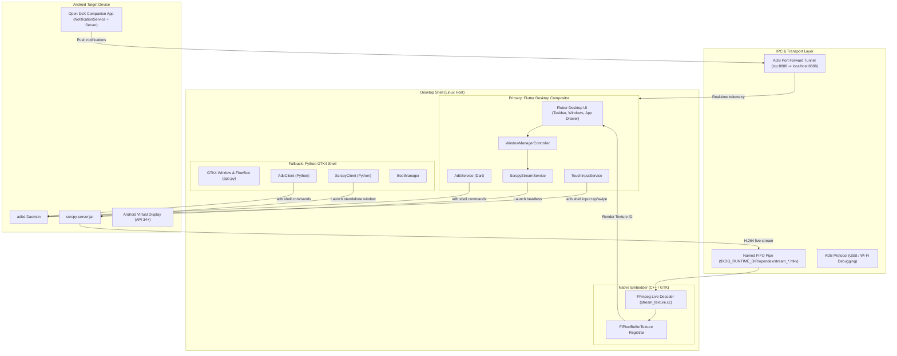
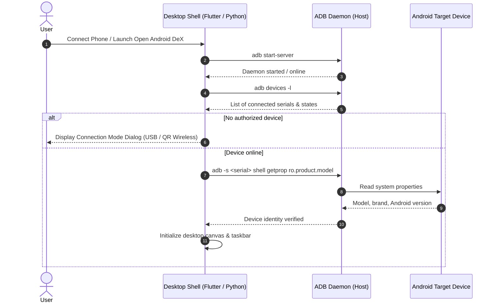
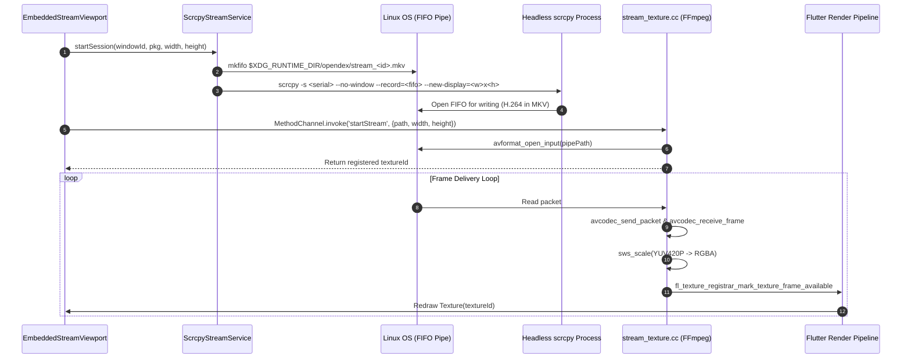

# Open Android DeX — Architecture & Technical Design

> **Document Version:** 1.0.0  
> **Status:** Official Architecture Documentation  
> **Target Audience:** Maintainers, Contributors, and System Architects  

---

## Table of Contents

1. [High-Level Architecture Overview](#1-high-level-architecture-overview)
2. [Subsystem Breakdown](#2-subsystem-breakdown)
   - [2.1 Flutter Desktop Compositor (`lib/`)](#21-flutter-desktop-compositor-lib)
   - [2.2 Native Linux Embedder & Video Decoder (`linux/`)](#22-native-linux-embedder--video-decoder-linux)
   - [2.3 Legacy Python / GTK4 Shell (`app.py`)](#23-legacy-python--gtk4-shell-apppy)
   - [2.4 Android Companion Bridge (`android_companion/`)](#24-android-companion-bridge-android_companion)
3. [End-to-End Data Flow](#3-end-to-end-data-flow)
   - [3.1 Staged Device Initialization Sequence](#31-staged-device-initialization-sequence)
   - [3.2 Screen Mirroring & Video Pipeline](#32-screen-mirroring--video-pipeline)
   - [3.3 Pointer & Touch Input Translation](#33-pointer--touch-input-translation)
   - [3.4 Telemetry & Notification Synchronization](#34-telemetry--notification-synchronization)
4. [Process Lifecycle & Resource Cleanup](#4-process-lifecycle--resource-cleanup)
   - [4.1 Headless scrcpy Process Management](#41-headless-scrcpy-process-management)
   - [4.2 Named Pipe (FIFO) Lifecycle](#42-named-pipe-fifo-lifecycle)
   - [4.3 Threading & Deadlock Prevention](#43-threading--deadlock-prevention)
5. [Window Management Architecture](#5-window-management-architecture)
   - [5.1 Z-Index & Focus Coordination](#51-z-index--focus-coordination)
   - [5.2 8-Direction Resizing & Geometry Preservation](#52-8-direction-resizing--geometry-preservation)
   - [5.3 Resolution Auto-Adaptation](#53-resolution-auto-adaptation)
6. [Component Comparison & Dual-Shell Strategy](#6-component-comparison--dual-shell-strategy)
7. [Error Handling & Recovery Strategies](#7-error-handling--recovery-strategies)

---

## 1. High-Level Architecture Overview

Open Android DeX bridges physical Android devices and Linux desktop operating systems (Wayland and X11), presenting an interactive multi-window workspace inspired by Samsung DeX.

The system is organized into two desktop shell implementations sharing common device protocols, coupled with an Android background companion service:

---

## 2. Subsystem Breakdown

### 2.1 Flutter Desktop Compositor (`lib/`)
The primary desktop interface is constructed with Flutter Desktop (`lib/`):
* **State Management**: Reactive state coordination through `ChangeNotifier` (`WindowManagerController`).
* **Desktop Workspaces**: `DexDesktopScreen` provides the master canvas with wallpaper rendering, icon grids, and window stacking.
* **Window Hierarchy**: `ResizableWindowFrame` wraps window content with an interactive title bar (minimize, maximize, close) and 8 mouse resize hit-test regions.
* **Embedded Viewport**: `EmbeddedStreamViewport` hosts the video `Texture` widget, listens to window size mutations, debounces resolution adjustments, and translates gestures.

### 2.2 Native Linux Embedder & Video Decoder (`linux/`)
Unlike traditional implementations that launch `scrcpy` in an external detached SDL window, Open Android DeX incorporates an in-process texture decoding pipeline:
* **Entry Point**: `linux/my_application.cc` initializes the GTK application, sets window size defaults, and registers the `OpenAndroidDexStreamPlugin` channel.
* **C++ Texture Engine**: `linux/stream_texture.cc` defines `StreamTexture`, a subclass of `FlPixelBufferTexture`.
* **FFmpeg Pipeline**: A dedicated worker thread (`stream_texture_worker`) opens the live container from the pipe, demuxes video packets with `libavformat`, decodes H.264/H.265 frames via `libavcodec`, converts pixel formats with `libswscale` to 32-bit RGBA, and invokes `fl_texture_registrar_mark_texture_frame_available`.

### 2.3 Legacy Python / GTK4 Shell (`app.py`)
Maintained as an ultra-lightweight, zero-compilation fallback:
* **UI Construction**: Pure PyGObject with GTK4 CSS styling mimicking Samsung DeX glassmorphism.
* **Device Boot Flow**: `BootManager` executes an asynchronous 5-stage initialization sequence off the main thread.
* **Process Model**: Invokes `scrcpy` in standalone window mode with `--window-title`, `-b`, and `--max-size`.

### 2.4 Android Companion Bridge (`android_companion/`)
An Android application written in Kotlin to provide zero-polling system integration:
* **`NotificationService.kt`**: Subclasses `NotificationListenerService` to receive real-time push events whenever notifications are posted or dismissed.
* **`CompanionServer.kt`**: Coroutine-based TCP server bound strictly to `127.0.0.1:8888`. It serializes notification metadata to JSON and broadcasts to connected desktop clients over ADB port forward.

---

## 3. End-to-End Data Flow

### 3.1 Staged Device Initialization Sequence

### 3.2 Screen Mirroring & Video Pipeline

### 3.3 Pointer & Touch Input Translation
1. The user clicks or drags inside the Flutter `EmbeddedStreamViewport`.
2. A `Listener` or `GestureDetector` captures local cursor offsets `(localX, localY)` relative to the widget bounding box.
3. [`TouchInputService.normalizeCoordinates()`](file:///root/open-android-dex/lib/services/touch_input_service.dart#L18) scales viewport coordinates to the target Android virtual display dimensions `(targetX, targetY)`.
4. Gestures are dispatched via non-blocking asynchronous `Process.run('adb', ['-s', serial, 'shell', 'input', 'tap', ...])` or throttled swipe commands (debounced at 120ms to prevent ADB command saturation).

---

## 4. Process Lifecycle & Resource Cleanup

### 4.1 Headless scrcpy Process Management
Each active application window in Flutter manages its own headless `scrcpy` subprocess:
* **Port Isolation**: Each session is assigned a dedicated base port range (`27183:27186`) incrementing per session to prevent ADB tunnel collisions.
* **Termination**: When a window is closed or minimized, `ScrcpyStreamService.stopSession()` sends `SIGTERM`, waits up to 250ms, and escalates to `SIGKILL` if the process fails to exit.
* **Disconnection Recovery**: Process exit listeners proactively update the window status pill and unregister textures.

### 4.2 Named Pipe (FIFO) Lifecycle
* **Security & Isolation**: Pipes are created under `$XDG_RUNTIME_DIR/opendex/stream_<windowId>.mkv` (mode 0700). If the environment variable is unset, it falls back to `/tmp`.
* **Cleanup Guarantee**: When `EmbeddedStreamViewport.dispose()` is executed, both `stopStream()` (freeing C++ buffers) and `cleanupPipe()` (deleting the filesystem inode) are called.

### 4.3 Threading & Deadlock Prevention
* **Off-Thread I/O**: All FFmpeg network and pipe read operations occur on a background POSIX thread spawned via `g_thread_new()`.
* **Interrupt Callback**: An FFmpeg interrupt callback (`stream_texture_interrupt_cb`) checks `self->is_running` to break out of blocking `avformat_open_input()` calls immediately when a window closes.
* **Main Loop Marshaling**: Frame availability signals are dispatched to GTK via `g_idle_add(on_frame_available_idle, ...)`.

---

## 5. Window Management Architecture

### 5.1 Z-Index & Focus Coordination
* Stored in `WindowManagerController` as a strictly monotonic integer counter `_topZIndex`.
* Clicking anywhere inside a window frame triggers `onPointerDown`, elevating the window's `zIndex` and setting it as `activeWindowId`.
* Flutter's `Stack` sorts children by `zIndex` on each rebuild so the active window is positioned at the top of the render tree.

### 5.2 8-Direction Resizing & Geometry Preservation
* Eight hit-test handles (Top, Bottom, Left, Right, 4 Corners) capture pointer updates without interfering with inner viewport touch dispatch.
* Pre-maximize geometry `(prevX, prevY, prevWidth, prevHeight)` is preserved in `DexWindow.saveGeometry()`. Double-clicking the title bar toggles between maximized fullscreen and restored geometry.

### 5.3 Resolution Auto-Adaptation
* While resizing, video frames scale linearly using hardware texture bilinear filtering.
* When resizing pauses for >450ms, a debounce timer triggers `_startStream()`, adjusting the headless `scrcpy` `--new-display` resolution to match the exact window aspect ratio.

---

## 6. Component Comparison & Dual-Shell Strategy

| Feature | Flutter Desktop Compositor | Python / GTK4 Shell |
| :--- | :--- | :--- |
| **Window Architecture** | Internal floating windows inside single canvas | External window per app managed by host compositor |
| **Video Rendering** | Native OpenGL/Vulkan texture (`stream_texture.cc`) | Standalone `scrcpy` SDL window |
| **Virtual Displays** | Supported (`--new-display=WxH/DPI`) | Primary display mirroring (`Display 0`) |
| **Host Resource Overhead** | ~120 MB RAM, GPU accelerated | ~45 MB RAM, low memory footprint |
| **Target Audience** | Full DeX workstation replacement | Lightweight / Embedded systems |

**Maintenance Strategy**: Both shells will be retained. The Flutter shell serves as the primary modern compositor; the Python/GTK4 shell serves as the lightweight desktop shell.

---

## 7. Error Handling & Recovery Strategies

1. **ADB Server Disconnection**:
   * Polling loops in both Flutter and Python detect connection drops within 2–4 seconds and update UI indicators to "Disconnected".
2. **Device Unauthorized State**:
   * Detected during boot sequence and connection checks; instructs the user to accept the RSA fingerprint prompt on their phone.
3. **Pipe Underflow / Corrupted Video Frame**:
   * Handled by FFmpeg packet discard logic. If no valid frame is available, `stream_texture_copy_pixels` supplies a constant 1x1 dark pixel buffer, preventing Flutter engine crashes.
