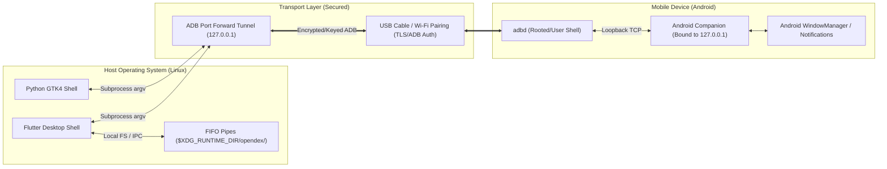

# Open Android DeX — Security Policy & Threat Model

> **Document Version:** 1.0.0  
> **Status:** Official Security Policy  
> **Scope:** Desktop Shells (Flutter & Python), Android Companion App, and IPC Bridges  

---

## Table of Contents

1. [Security Policy & Vulnerability Reporting](#1-security-policy--vulnerability-reporting)
2. [Threat Model & Trust Boundaries](#2-threat-model--trust-boundaries)
3. [Component Security Analysis](#3-component-security-analysis)
   - [3.1 Android Companion Socket Security](#31-android-companion-socket-security)
   - [3.2 ADB Command Execution & Shell Injection Defense](#32-adb-command-execution--shell-injection-defense)
   - [3.3 Named Pipe (FIFO) & File System Permissions](#33-named-pipe-fifo--file-system-permissions)
   - [3.4 Android Permission Least-Privilege Review](#34-android-permission-least-privilege-review)
   - [3.5 Sensitive Data in Telemetry & Logs](#35-sensitive-data-in-telemetry--logs)
4. [Mitigations & Hardening Implemented](#4-mitigations--hardening-implemented)
5. [Contributor Security Guidelines](#5-contributor-security-guidelines)

---

## 1. Security Policy & Vulnerability Reporting

The Open Android DeX maintainers take the security of connected mobile devices and desktop systems seriously. If you discover a potential vulnerability, **please do not open a public GitHub issue**.

### Reporting Procedure
Please report security issues privately by emailing:
* **Security Contact:** `security@bitmanipulators.org` (or via private GitHub Security Advisory)

Please include:
1. Detailed description of the vulnerability and attack vector.
2. Step-by-step reproduction instructions or proof-of-concept.
3. Affected components (Flutter, Python GTK, or Android Companion).
4. Potential impact on the device or host system.

We will acknowledge receipt within 48 hours and work with you to coordinate a patched release prior to public disclosure.

---

## 2. Threat Model & Trust Boundaries



### Trust Assumptions
1. **The physical USB or Wireless Pairing link** is authenticated via the user accepting the RSA key fingerprint on the phone screen.
2. **The Linux Desktop user account** running Open Android DeX is considered trusted by the user, but multi-user shared environments must prevent unprivileged local users from hijacking sessions.
3. **The local network (Wi-Fi / LAN)** is considered untrusted. No service may listen on `0.0.0.0` or broadcast sensitive notification telemetry over unauthenticated network sockets.

---

## 3. Component Security Analysis

### 3.1 Android Companion Socket Security
* **Vulnerability Identified:** In initial prototypes, `CompanionServer.kt` initialized `ServerSocket(8888)` on wildcard `0.0.0.0:8888`, exposing intercepted notification payloads (SMS, OTPs, WhatsApp chats) to any device sharing the local Wi-Fi.
* **Mitigation Implemented:**  
  `CompanionServer` has been hardened to bind strictly to loopback:
  ```kotlin
  ServerSocket(PORT, 50, InetAddress.getByName("127.0.0.1"))
  ```
  This restricts socket access exclusively to authenticated ADB port forwarding (`adb forward tcp:8888 tcp:8888`). Connections originating from outside the device loopback are rejected by the kernel.

### 3.2 ADB Command Execution & Shell Injection Defense
* **Risk:** Subprocess execution of `adb shell ...` using unescaped user strings can result in command injection.
* **Mitigations Implemented:**
  1. Both Dart (`Process.run`) and Python (`subprocess.run`) pass arguments as structured `List<String>` arrays rather than raw shell strings (`shell=False`).
  2. In [`adb_client.py`](file:///root/open-android-dex/adb_client.py), intent parameters are broken into independent `-a` and `-d` elements, preventing parameter injection attacks.
  3. Text entry injection in [`TouchInputService`](file:///root/open-android-dex/lib/services/touch_input_service.dart#L246) escapes whitespace and metacharacters before executing `input text`.

### 3.3 Named Pipe (FIFO) & File System Permissions
* **Risk:** Creation of named pipes in global `/tmp` allows symlink pre-creation attacks and permission collisions in multi-user environments.
* **Mitigations Implemented:**
  1. [`ScrcpyStreamService`](file:///root/open-android-dex/lib/services/scrcpy_stream_service.dart#L224) prioritizes `$XDG_RUNTIME_DIR/opendex/`, which is user-owned (permissions `0700`) and inaccessible to other local users.
  2. Stale pipes are explicitly unlinked on session disposal.

### 3.4 Android Permission Least-Privilege Review
The Android companion manifest requests the following permissions:
* `android.permission.INTERNET`: Required to create local TCP loopback sockets.
* `android.permission.FOREGROUND_SERVICE` & `android.permission.FOREGROUND_SERVICE_CONNECTED_DEVICE`: Required by Android 14+ to keep the telemetry daemon alive.
* `android.permission.BIND_NOTIFICATION_LISTENER_SERVICE`: Required to intercept notifications. This permission must be explicitly granted by the user in system settings.
* `android.permission.WAKE_LOCK`: Required to maintain screen-streaming wakefulness during active sessions.

### 3.5 Sensitive Data in Telemetry & Logs
* **Redaction Policy:** Notification content, clipboard buffers, and keystroke logs must never be written to stdout/stderr in production builds.
* Diagnostic logs only output process exit codes, resolution dimensions, and sanitized package identifiers.

---

## 4. Mitigations & Hardening Implemented

| Area | Threat | Mitigation Implemented |
| :--- | :--- | :--- |
| **Companion Socket** | Unauthorized network eavesdropping | Bound strictly to `127.0.0.1` loopback interface |
| **Pipe Hijacking** | Multi-user race condition / symlink attacks | Relocated pipes to secure `$XDG_RUNTIME_DIR/opendex/` |
| **ADB Parameter Injection** | Malformed intent strings executing arbitrary code | Parameterized arrays for `am start` and `am start-component` |
| **GDK Worker Thread Crash** | Unhandled exception killing GTK UI | Cached display theme on main thread with fallback |

---

## 5. Contributor Security Guidelines

1. **Never store credentials or private keys**: No test keystores, API tokens, or ADB private keys (`adbkey`) may be committed to this repository.
2. **Never use `shell=True` in Python**: Always pass commands as a list of arguments to `subprocess.run` or `subprocess.Popen`.
3. **Never bind to `0.0.0.0`**: Sockets on the mobile device must bind to `127.0.0.1` unless end-to-end TLS and token authentication are implemented.
4. **Always sanitize package names**: Validate package names against `^[a-zA-Z0-9_.]+$` before invoking ADB shell commands.
