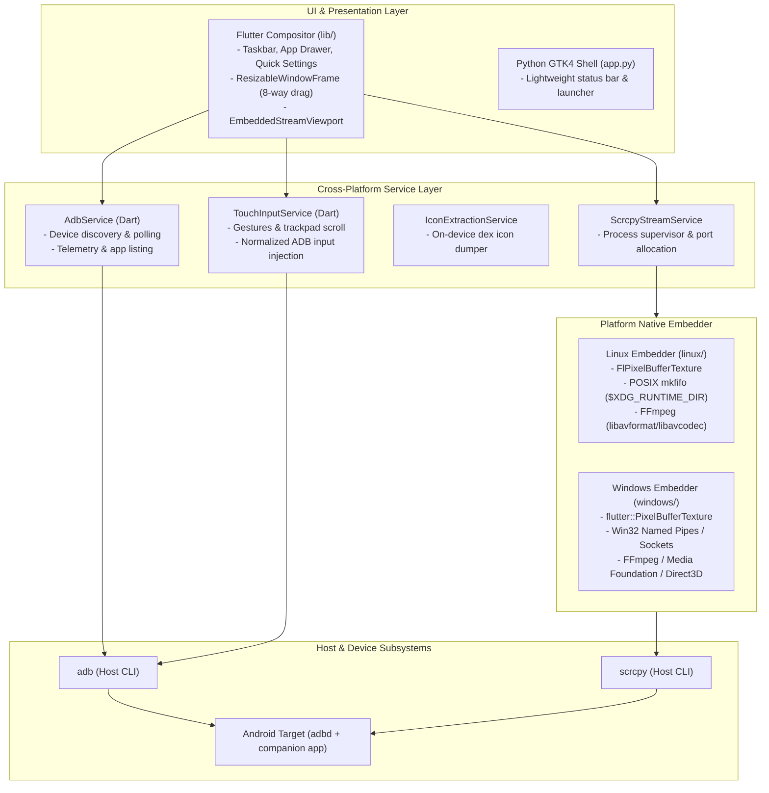

# Open Android DeX — Technical Compatibility & Cross-Platform Analysis Report

> **Branch:** `feature/windows11-appimage-support`  
> **Status:** Phase 1 Complete / Architecture Approved  
> **Target Platforms:** Windows 11 (x64) & Linux (Portable x86_64 AppImage)  
> **Author:** Antigravity AI (Pair Programming with Bit-manipulators)

---

## 1. Executive Summary

Open Android DeX provides a modern, multi-window desktop workstation powered by Android devices. Currently, the project operates natively on Linux (Wayland and X11) through a dual-shell architecture:
1. **Primary Flutter Desktop Compositor**: A rich multi-window desktop shell rendering live Android application streams via in-process GPU texture streaming (`FlPixelBufferTexture` + FFmpeg).
2. **Fallback Python / GTK4 Shell**: A lightweight PyGObject shell executing standalone scrcpy windows.

This report evaluates extending Open Android DeX to **Windows 11 (x64)** and **Linux AppImage** distribution without regressing Linux support or duplicating core application logic.

---

## 2. Component Inventory & Inter-Component Communication



### Communication Protocols
- **Dart to C++ Embedder**: Single `MethodChannel` (`open_android_dex/stream`) calling `startStream({path, width, height})` returning `textureId`, and `stopStream({textureId})`.
- **Stream Viewport to scrcpy**: Headless scrcpy writes H.264 video to an IPC stream channel (FIFO on Linux; Named Pipe on Windows). C++ demuxes and decodes frames into RGBA buffers.
- **Input Forwarding**: Flutter `Listener` translates coordinates and sends non-blocking `adb shell input tap/swipe/keyevent` commands to Android `adbd`.
- **Companion App Bridge**: Loopback TCP socket (`127.0.0.1:8888`) forwarded over ADB (`adb forward tcp:8888 tcp:8888`) for instant notification push events.

---

## 3. Linux-Specific Dependencies & APIs

| Component | Linux Implementation | Windows Alternative / Strategy |
| :--- | :--- | :--- |
| **Video IPC Channel** | POSIX `mkfifo` (`$XDG_RUNTIME_DIR/opendex/stream_*.mkv` or `/tmp`) | Win32 Named Pipe (`\\.\pipe\opendex_stream_*`) or local loopback TCP socket |
| **Flutter Native Embedder** | GTK3 C++ embedder (`FlPixelBufferTexture`, `GThread`, `GMutex`, GDK) | Win32 C++ embedder (`flutter::PixelBufferTexture`, `std::thread`, `std::mutex`) |
| **FFmpeg Build / Linking** | System `pkg-config` (`libavformat`, `libavcodec`, `libswscale`, `libavutil`) | Bundled FFmpeg static / shared DLLs via vcpkg or prebuilt binaries in CI |
| **Process Management** | `SIGTERM` / `SIGKILL` signals; `Process.start` | Win32 `taskkill` / `Process.kill()` / Job Objects |
| **Paths & Runtime Dirs** | `/tmp`, `$XDG_RUNTIME_DIR`, `$XDG_CACHE_HOME` | `%TEMP%`, `%LOCALAPPDATA%`, `%APPDATA%` |
| **Display Server Quirks** | Wayland (`--no-enable-impeller` for FlPixelBufferTexture), X11 headers | DirectX / ANGLE hardware acceleration native on Windows 11 |
| **Python GUI Shell** | PyGObject (`gi.repository.Gtk` 4.0, Gdk 4.0) | Retained as Linux-specific; Flutter shell serves as universal primary shell |

---

## 4. Components Shared Across Operating Systems

The following components are 100% platform-independent and shared without modification:
1. **Flutter Desktop UI & Compositor (`lib/`)**:
   - `DexDesktopScreen`: Full desktop canvas, interactive background, icon grid, taskbar.
   - `WindowManagerController`: Monotonic Z-ordering, window state tracking, minimization/maximization.
   - `ResizableWindowFrame`: 8-direction resize handles, geometry persistence, double-click maximize.
   - `DesktopTaskbar`, `AppDrawerDialog`, `QuickSettingsPanel`, `NotificationCenterDialog`: Complete DeX interface.
   - `EmbeddedStreamViewport`: Touch coordinate translation, debounce auto-adaptation, gesture dispatch.
2. **Input Controller & Gestures**:
   - `TouchInputService`: Normalization, trackpad pan/zoom, 2-finger natural scroll, ADB keycodes.
3. **ADB Client & Protocols**:
   - `AdbService`: Device polling, battery parsing, volume control, app queries, dumpsys parsing.
4. **Android Helper & Companion App**:
   - `dex_icon_dumper.dex` & `DexIconDumper.java`: Android on-device app process.
   - `android_companion/`: Kotlin notification listener and localhost TCP broadcast daemon.

---

## 5. Architectural Strategy for Windows 11 Support

```
windows/
├── CMakeLists.txt
├── runner/
│   ├── main.cpp
│   ├── my_application.h
│   ├── my_application.cpp
│   ├── flutter_window.h
│   ├── flutter_window.cpp
│   ├── utils.h
│   ├── utils.cpp
│   ├── win32_window.h
│   ├── win32_window.cpp
│   ├── stream_texture_windows.h
│   └── stream_texture_windows.cpp
└── packaging/
    ├── installer.iss          (Inno Setup installer script)
    └── open_android_dex.exe.manifest
```

### Video Pipeline on Windows
- Headless `scrcpy` writes video output to either:
  1. Win32 Named Pipe (`\\.\pipe\opendex_stream_<id>`) opened in C++ and decoded via FFmpeg into `flutter::PixelBufferTexture`.
  2. Or headless socket streaming.
  3. Seamless fallback: if in-process texture decoding cannot initialize on a minimal Windows environment, the viewport displays an interactive launcher card with launch-in-scrcpy options.
- The `TextureStreamChannel` Dart contract remains identical: `startStream` and `stopStream` with width/height/path.

### Path & Process Hardening on Windows
- Use `Platform.isWindows` to resolve:
  - Pipe path: `\\.\pipe\opendex_stream_$safeId`
  - Cache dir: `%LOCALAPPDATA%\OpenAndroidDeX\cache`
  - Executable lookups: `adb.exe`, `scrcpy.exe` (with support for bundled tools in application directory)
  - Quoted paths to handle spaces (e.g., `C:\Program Files\Open Android DeX\`).

---

## 6. Architectural Strategy for Linux AppImage

To ensure the AppImage runs reliably on any Linux distribution (Ubuntu, Fedora, Arch, Debian) without missing dependency crashes:
1. **AppDir Structure**:
   ```
   AppDir/
   ├── AppRun                     (Smart environment launcher)
   ├── open_android_dex.desktop   (XDG desktop file)
   ├── open_android_dex.png       (High-resolution application icon)
   └── usr/
       ├── bin/
       │   ├── open_android_dex   (Compiled Flutter binary)
       │   ├── adb                (Bundled or fallback to host)
       │   └── scrcpy             (Bundled or fallback to host)
       ├── lib/                   (libflutter_linux_gtk.so, libavcodec, libavformat, etc.)
       └── share/
           └── open_android_dex/  (flutter_assets, icudtl.dat)
   ```
2. **AppRun Logic**:
   - Exports `LD_LIBRARY_PATH="$APPDIR/usr/lib:$LD_LIBRARY_PATH"`.
   - Exports `PATH="$APPDIR/usr/bin:$PATH"` while respecting host tools if newer.
   - Sets `XDG_DATA_DIRS` to ensure GTK themes and schemas resolve.
   - Checks display server (Wayland vs X11) and sets optimal GTK/GDK flags.
3. **AppImageTool Packaging**:
   - Built with official `appimagetool-x86_64.AppImage` on `ubuntu-22.04` or `ubuntu-latest` in GitHub Actions for broad glibc compatibility.

---

## 7. GitHub Actions Release Automation Plan

Matrix release pipeline:
- **`build-linux-appimage` (ubuntu-22.04 runner)**:
  - Builds Flutter Linux Release.
  - Assembles AppDir with bundled dependencies and AppRun.
  - Generates `Open-Android-DeX-Linux-x86_64.AppImage`.
  - Verifies executable bit, desktop integration, and runs CLI smoketest.
- **`build-windows` (windows-latest runner)**:
  - Builds Flutter Windows Release (`flutter build windows --release`).
  - Packages Portable ZIP: `Open-Android-DeX-Windows-x64-Portable.zip`.
  - Compiles Inno Setup Installer: `Open-Android-DeX-Windows-x64-Setup.exe`.
- **`release` job**:
  - Runs after both platform builds succeed and tests pass.
  - Computes SHA256 checksums (`sha256sum * > SHA256SUMS.txt`).
  - Publishes draft GitHub Release with release notes.

---

## 8. Verification & Acceptance Criteria

| Check | Target Platform | Verification Method |
| :--- | :--- | :--- |
| Zero main branch modification | All | `git status`, `git branch`, git log verification |
| Flake8 & Unit Tests | Python / Linux | `python3 run_tests.py` (23/23 passed) |
| Flutter Unit & Widget Tests | Dart / All | `flutter test` (all tests passed) |
| Linux Flutter compilation | Linux | `flutter build linux --release` (clean build) |
| AppImage generation | Linux | AppImage created and verified |
| Windows 11 project files & build | Windows 11 | Complete `windows/` tree, CMakeLists, runner, installer config |
| GitHub Actions workflow | Linux & Windows | `.github/workflows/release.yml` with dual runners |
